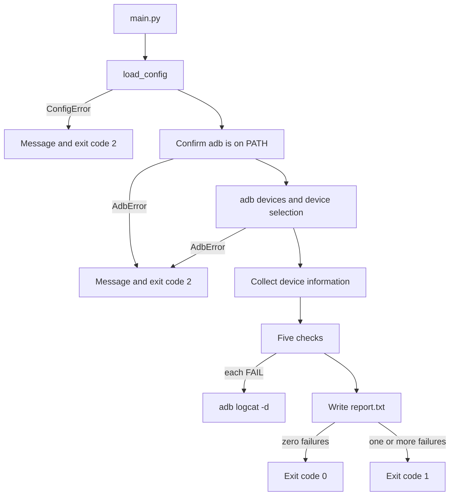

# Implementation Plan: Android Python Automation

This document is the implementation plan. It maps the Android Python Automation assignment, then fixes the module boundaries and the order of work.

The tool is a Python command-line program. It reads `config.json`, selects one Android device through ADB, runs five checks, saves `adb logcat -d` when a check fails, and writes `report.txt`. Unit tests run without a physical device.

The repository contains the working program, tests, and CI workflow described here.

## 1. Repository state

The assignment calls the layout a suggested project structure and labels the root `android_automation_solution/`. That label is the directory a reviewer opens. It is not a folder that must be nested inside another directory.

This repository is that directory. Cloning it shows the diagram's files at the top level. There is no nested `android_automation_solution/` directory, and adding one would hide `main.py` one level deeper than the diagram.

The diagram and this root contain the same required paths:

```text
main.py
config.json
android_runner/
    adb.py
    config.py
    runner.py
    report.py
tests/
README.md
logs/
```

`android_runner/__init__.py` is an empty package marker so `android_runner` imports as a package. It is not drawn in the diagram. `pyproject.toml` and `.github/workflows/ci.yml` are also outside the diagram; both are described in section 2. `tests/.gitkeep` and `logs/.gitkeep` keep those directories in git. `.gitignore` ignores generated files inside `logs/` and ignores `report.txt`.

Every source file, comment, configuration value, report, and document is written in English.

## 2. Deliverables

| File | Role |
| --- | --- |
| `main.py` | Entry point. Loads configuration, selects a device, runs checks, writes the report, and exits with a clear status code. |
| `config.json` | Values the user edits. |
| `android_runner/config.py` | Load and validate configuration. |
| `android_runner/adb.py` | Run ADB, parse `adb devices`, read device details, and capture `logcat`. |
| `android_runner/runner.py` | The five checks and failure-log capture. |
| `android_runner/report.py` | Build `report.txt`. |
| `tests/` | `pytest` tests that mock `subprocess`. |
| `.github/workflows/ci.yml` | Run the tests on every push and pull request. |
| `README.md` | Setup, usage, structure, failure behavior, CI, and improvement ideas. |
| `pyproject.toml` | Python 3.12 or newer, with `pytest` as the only development dependency. No runtime dependencies. |

`logs/` is created by the program when a check fails. Generated log files are not committed.

`.github/workflows/ci.yml` is not in the assignment diagram. It is an extra file, and it is part of this repository. Section 4.10 is the contract for that file. The file already in the repository matches that contract: Ubuntu, Python 3.12, `pytest`, on every push and pull request, with no ADB install and no device. The PDF deliverables stay the required set: source, `config.json`, tests, `README.md`, a `report.txt` from a run, and `logs/` when a check fails.

Optional assignment extensions stay out of the code. The README lists them as future work: interval runs, logcat filtering, a JSON or HTML report, and extra checks such as storage, network, foreground activity, and screen state. Selecting a device with `device_id` is in scope, because it is part of multiple-device handling.

## 3. Execution flow



Required order:

1. Validate `config.json` before any ADB call.
2. Confirm that `adb` is on `PATH`.
3. Run `adb devices` and select one device whose state is `device`.
4. Collect device information.
5. Run the five checks in order.
6. On every `FAIL`, try to save `adb logcat -d`. A logcat failure does not change the check result.
7. Write `report.txt` with device details, results, totals, and the overall status.
8. Exit with a useful message for expected setup failures, without a traceback.

`report.txt` is written only after a device is selected and the checks have run. A configuration error, a missing ADB binary, or a device-selection failure stops before the report.

## 4. Detailed requirements

### 4.1 Configuration

Example `config.json`:

```json
{
  "package_name": "com.example.demo",
  "minimum_android_version": 10,
  "minimum_battery": 20
}
```

Required fields:

- `package_name`: an Android package name string, for example `com.example.demo`.
- `minimum_android_version`: an integer, the minimum Android version.
- `minimum_battery`: an integer, the minimum battery percentage.

Optional field:

- `device_id`: a device serial string. A missing key, `null`, or `""` means no explicit selection.

Validation rules in `load_config`:

- A missing or unreadable file names the path.
- Invalid JSON names the path, the parser message, and the line and column.
- The root value must be a JSON object.
- A missing required field names that field.
- An unknown field is rejected, so a typo is not ignored.
- `package_name` matches `^[A-Za-z][A-Za-z0-9_]*(\.[A-Za-z][A-Za-z0-9_]*)+$`.
- `minimum_android_version` is an integer from 1 through 99. `true` and `10.0` are rejected. In Python `bool` is a subclass of `int`, so the boolean check comes before the integer check.
- `minimum_battery` is an integer from 0 through 100. The value `100` is valid. The battery check requires a level strictly above it, so a threshold of 100 always fails that check.
- A `device_id` with leading or trailing whitespace is rejected.

`load_config` raises `ConfigError` with one sentence. It does not print and it does not call `sys.exit`. `main.py` prints the message to stderr and exits with code 2.

### 4.2 Device detection

The command is `adb devices`, without `shell=True`. Parsing rules:

- Skip blank lines, the header `List of devices attached`, and lines that start with `*`.
- A valid line has the serial as the first token and the state as the second token.

Continue only with a device whose state is `device`.

| Situation | Response |
| --- | --- |
| `adb` is not on `PATH`, or the launch raises `FileNotFoundError` | Explain that Android SDK Platform-Tools must be installed and that `platform-tools` must be on `PATH`. Tell the user to verify with `adb version`. |
| No device lines | `No Android device or emulator is connected.` |
| Devices are listed and none has state `device` | Name every serial and its state. An `unauthorized` device is told to accept the USB debugging prompt. An `offline` device is told to reconnect. A state that is not present is not mentioned. |
| One device has state `device`, and `device_id` is unset | Select it. Extra unauthorized devices do not block that choice. |
| Several devices have state `device`, and `device_id` is unset | Exit with code 2. Stderr is one sentence and names only the ready serials: `More than one Android device is ready (SERIAL, SERIAL); set device_id in config.json to one of these serials.` |
| `device_id` is set and that device has state `device` | Select it even when other devices are connected. |
| `device_id` is set and that device is connected in another state | Name the serial and the state, then give the same correction used when no device is ready. |
| `device_id` is set and that device is absent | Say it was not found, and list the connected devices with their states. |

Selection is not interactive. The assignment says: if more than one usable device is connected, either select the configured `device_id` or ask the user to configure one. A configured `device_id` whose state is `device` is the first branch. The second branch is the sentence above: it lists the ready serials and tells the user to set `device_id` in `config.json`. The program then exits. It does not call `input()`, it does not read stdin, and it does not pick a device by itself. Devices whose state is not `device` are left out of that serial list. The sentence goes to stderr, contains no traceback, and does not write `report.txt`. The unit test asserts that full sentence, and `main` returns 2 for it without writing `report.txt`.

### 4.3 Device information

After selection, five values are collected. All of them appear in the report.

| Value | Command |
| --- | --- |
| Device ID | The selected serial |
| Android version | `adb -s SERIAL shell getprop ro.build.version.release` |
| Model | `adb -s SERIAL shell getprop ro.product.model` |
| Manufacturer | `adb -s SERIAL shell getprop ro.product.manufacturer` |
| Battery | `adb -s SERIAL shell dumpsys battery` |

The major version is the leading integer: `14` is 14 and `8.1.0` is 8. A string with no leading digits is kept as-is, and the version check fails.

Battery: read `level:` and `scale:` from `dumpsys battery`. When `scale` is missing or `100`, the percentage is `level`. When `scale` is present and not `100`, the percentage is `round(level * 100 / scale)`. If `level` is missing, the battery check fails.

A device-info field that cannot be read is stored as missing. A missing model or manufacturer is shown as `unknown` and is not its own check. A missing version or battery fails the matching check.

Every ADB command uses a timeout of 20 seconds.

### 4.4 The five checks

The order is fixed. Each result is `PASS`, `FAIL`, or `SKIP`, with a short explanation.

| Check | Command | Pass condition | Failure |
| --- | --- | --- | --- |
| Device is reachable | `adb -s SERIAL shell echo hello` | Exit code 0 and stripped `stdout` is `hello` | Any other result, including a timeout |
| Android version | The collected `ro.build.version.release` value | The major version is greater than or equal to `minimum_android_version` | A lower version, or a version that cannot be parsed |
| Battery level | The collected battery percentage | The percentage is strictly greater than `minimum_battery` | Equal to the threshold, below it, or unreadable |
| Application installation | `adb -s SERIAL shell pm path PACKAGE` | Exit code 0 and a line starts with `package:` | No package path |
| Launch application | `adb -s SERIAL shell monkey -p PACKAGE -c android.intent.category.LAUNCHER 1` | Exit code 0, and the output does not contain `No activities found` or `monkey aborted` | The command failed |

The assignment states: if the application is not installed, report the installation test as `FAIL` and the launch test as `SKIP`. When `pm path` does not report a package path, installation is `FAIL` and launch is `SKIP` with the explanation `Skipped because PACKAGE is not installed.` `monkey` is not run in that case. The sample report in section 4.6 is that case. A timeout or other ADB failure during the installation check is also `FAIL`, and launch is `SKIP` because installation could not be confirmed. That explanation does not say the package is not installed.

The launch check is a command-level check. There is no visual UI verification.

`SKIP` is not a failure. The overall status is `PASS` when the failure count is zero.

A timeout, a non-zero exit, or unexpected output inside a check makes that check `FAIL` with one short sentence. The remaining checks continue.

### 4.5 Failure logs

For every `FAIL`:

1. Create `logs/` if it does not exist.
2. Run `adb -s SERIAL logcat -d`.
3. Save `logs/YYYYMMDD-HHMMSS_test_slug.txt`. The check name becomes lowercase with `_` instead of spaces. Two checks that fail in the same second stay unique because the check name is part of the file name.
4. If logcat fails or times out, the check status stays `FAIL`, the original explanation is kept, and the report adds a `Log capture failed` line.

`PASS` and `SKIP` do not create a log file.

### 4.6 Report

`report.txt` is written in the current directory unless another path is given. The layout is fixed so tests can assert it:

```text
Android Automation Report
=========================

Device
------
Device ID: emulator-5554
Android version: 14
Model: sdk_gphone64_arm64
Manufacturer: Google
Battery: 86%

Checks
------
Device is reachable: PASS
    Command 'echo hello' succeeded and returned 'hello'.
Android version: PASS
    Major version 14 is greater than or equal to minimum 10.
Battery level: FAIL
    Battery level is 15%, which is not strictly above 20%.
    Log: logs/20261013-215301_battery_level.txt
Application installation: FAIL
    Package com.example.demo is not installed.
    Log: logs/20261013-215302_application_installation.txt
Launch application: SKIP
    Skipped because com.example.demo is not installed.

Totals
------
Passed: 2
Failed: 2
Skipped: 1
All: 5

Overall: FAIL
```

The report includes device details, every check with a status and explanation, the counts `Passed`, `Failed`, `Skipped`, and `All`, and `Overall`. `Overall` is `PASS` only when `Failed` is 0.

The `Log` line appears only when a file was saved. The `Log capture failed` line appears only when capture failed.

### 4.7 Clean exit

Expected messages go to stderr as one readable sentence. They do not include a traceback.

| Event | Exit code | Report |
| --- | --- | --- |
| Configuration is missing or invalid | 2 | Not written |
| ADB is missing, no device is connected, a device is unauthorized or offline, or a device cannot be selected | 2 | Not written |
| Checks ran and at least one result is `FAIL` | 1 | Written |
| Checks ran and no result is `FAIL` | 0 | Written |

An unexpected exception that is not `ConfigError` or `AdbError` propagates. The program does not use a blanket `except Exception`, so a bug stays visible.

The documented command is `python main.py`. It reads `config.json`, writes `report.txt`, and saves failure logs under `logs/`.

### 4.8 Automated tests

Minimum coverage from the assignment:

- Valid configuration and invalid configuration.
- Detection of an online device and an `unauthorized` device.
- One complete passing run.
- One failing check.
- Log capture.
- Report totals.

Additional coverage for the error table and the check matrix:

- No device, an `offline` device, several devices without `device_id`, and several devices with a matching `device_id`.
- Missing `adb`.
- A battery level equal to the threshold fails, and a level above the threshold passes.
- A missing package is `FAIL` for installation and `SKIP` for launch.
- A logcat failure keeps the original `FAIL`.
- `main` returns 2 without a traceback for a broken configuration, 1 for a failing report, and 0 for a passing report.

Tests mock `subprocess.run` inside `android_runner.adb`. They do not need an `adb` binary or a device.

### 4.9 README

The README explains:

- Prerequisites: Python 3.12, Platform-Tools, USB debugging, and an authorized device or emulator.
- How to edit `config.json`, including `device_id`.
- How to run the tool and how to run `pytest`.
- Project structure and the important decisions: no runtime dependencies, non-interactive device selection, `monkey` for launch, battery strictly above the threshold, and best-effort logcat.
- Failure behavior, exit codes, and the fact that setup failures do not write a report.
- The assumption that launch is a command check, not a screen check.
- CI.
- Future improvements, based on the optional assignment extensions.
- A short sample `report.txt` inside the document.

### 4.10 CI

`.github/workflows/ci.yml` is the workflow this plan promises. It is already in the repository, and a reviewer can check the file against this block:

```yaml
name: Tests

on:
  push:
  pull_request:

jobs:
  pytest:
    runs-on: ubuntu-latest
    steps:
      - name: Check out the repository
        uses: actions/checkout@v4

      - name: Set up Python 3.12
        uses: actions/setup-python@v5
        with:
          python-version: "3.12"

      - name: Install pytest
        run: python -m pip install pytest

      - name: Run pytest
        run: pytest
```

The job does not install ADB and it does not use a device. The assignment PDF does not mention this file. The file stays because the project runs its tests on every push and pull request.

### 4.11 Acceptance criteria

- The project starts with a Python command documented in the README.
- Invalid JSON or invalid values produce a clear message.
- The no-device, unauthorized, offline, and multiple-device cases are handled.
- All five checks produce an explicit result.
- The report includes device details, each result, totals, and the overall status.
- Each failed check attempts to save logcat output under `logs/`.
- Tests run without a device and cover success and failure paths.
- The README gives another developer enough information to run and assess the project.

## 5. Design decisions

- Python 3.12 or newer, and the standard library only at runtime. ADB goes through `subprocess` with an argument list, not through `adbutils` and not with `shell=True`.
- Each module raises its own exception and does not exit. Only `main.py` prints and chooses the exit code.
- `AdbClient` owns command construction and the call to `subprocess.run`, so tests have one mock point.
- Device-info collection is separate from the checks. The report can show model and manufacturer when another check fails.
- The version check and the battery check use values already collected. They do not call ADB again.
- Launch uses `monkey` with category `android.intent.category.LAUNCHER`, because the activity name is not required.
- User-facing messages are in English, as are the report and the README.
- The existing `.gitignore` keeps generated `logs/` contents and `report.txt` out of git. `logs/.gitkeep` stays tracked.

## 6. Module contracts

`config.py`

- `ConfigError`
- `AppConfig`: `package_name`, `minimum_android_version`, `minimum_battery`, `device_id: str | None`
- `load_config(path) -> AppConfig`

`adb.py`

- `AdbError`
- `DeviceRecord`: `serial`, `state`
- `DeviceInfo`: `serial`, `android_version`, `android_major: int | None`, `model`, `manufacturer`, `battery_percent: int | None`
- `CommandResult`: `returncode`, `stdout`, `stderr`
- `AdbClient.list_devices()`
- `AdbClient.select_device(device_id) -> str`
- `AdbClient.read_device_info(serial) -> DeviceInfo`
- `AdbClient.shell(serial, *args) -> CommandResult`
- `AdbClient.launch_package(serial, package_name) -> CommandResult`
- `AdbClient.logcat(serial) -> str`

`shell` returns a result even when the exit code is not 0. It raises `AdbError` when `adb` is missing or when the command times out. Deciding that a package is not installed belongs to the runner, not to the ADB layer.

`runner.py`

- `Status`: `PASS`, `FAIL`, `SKIP`
- `CheckResult`: `name`, `status`, `explanation`, `log_path: Path | None`, `log_error: str | None`
- `run_checks(adb, config, info, logs_dir) -> list[CheckResult]`

`report.py`

- `render_report(info, results) -> str`
- `write_report(path, info, results) -> None`

`main.py`

- `main(argv: list[str] | None = None) -> int`
- `if __name__ == "__main__": raise SystemExit(main())`

## 7. Tests by file

`tests/test_config.py`

Temporary JSON files. No ADB mock. Covers a valid file, a present `device_id`, an empty `device_id`, a missing file, broken JSON, a non-object root, a missing field, an unknown field, a wrong type, a boolean, a float, and an out-of-range value.

`tests/test_adb.py`

`unittest.mock.patch` on `android_runner.adb.subprocess.run`, and on `shutil.which` when testing a missing ADB binary. Covers `adb devices` parsing, a single device, unauthorized, offline, no device, several devices, `device_id`, `getprop` and `dumpsys battery` parsing, timeout, and `logcat`.

`tests/test_report.py`

Assertions on the string returned by `render_report`: five device fields, five results, totals, `Overall: PASS` with no failures, `Overall: FAIL` with a failure, and a log line.

`tests/test_runner.py`

`AdbClient` is replaced by a fake. Covers a fully passing run, a battery level equal to the threshold, a missing package with `SKIP` for launch, a log file written on `FAIL`, and continuation after logcat fails.

`tests/test_main.py`

Calls `main()` in-process. A broken configuration returns 2 and stderr contains the field name without `Traceback`. A mocked passing run returns 0 and writes a report. A run with a failing check returns 1.

## 8. Implementation steps

Each step ends when its tests pass. The next step starts only after the previous step is green.

### Step 1. Project setup and configuration tests

Files: `pyproject.toml`, `android_runner/config.py`, `config.json`, `tests/test_config.py`.

`pyproject.toml` sets `requires-python = ">=3.12"`, a dev group with `pytest`, and `pythonpath = ["."]` so tests import `android_runner`.

Done when `pytest tests/test_config.py` passes.

### Step 2. ADB layer

Files: `android_runner/adb.py`, `tests/test_adb.py`.

Device parsing, selection, device info, shell, launch, and logcat. Every test uses a mock.

Done when `pytest tests/test_adb.py tests/test_config.py` passes.

### Step 3. Report

Files: `android_runner/report.py`, `tests/test_report.py`.

The report is built from data objects, with no ADB.

Done when `pytest` on the three test files passes.

### Step 4. The five checks and logs

Files: `android_runner/runner.py`, `tests/test_runner.py`.

This step closes the `PASS`, `FAIL`, and `SKIP` conditions and logcat saving.

Done when the suite so far passes, including a full passing run and a failing check with a log.

### Step 5. Entry point

Files: `main.py`, `tests/test_main.py`.

Wire the order: configuration, device selection, information, checks, report, and exit codes 0, 1, and 2.

Done when the full `pytest` suite passes without ADB.

### Step 6. CI

File: `.github/workflows/ci.yml`.

The file is the workflow in section 4.10. Done when that file triggers on push and pull request, uses `ubuntu-latest` and Python 3.12, installs `pytest`, runs `pytest`, and does not install ADB.

### Step 7. README

File: `README.md`.

Cover the documentation items in section 4.9, including a sample report and the extensions that were not implemented.

### Step 8. Final verification

Run `pytest` locally and confirm that every acceptance criterion in section 4.11 is backed by code or documentation. A physical device is not required to finish these steps. A run on a real device is a separate manual check if a device is connected while the work is in progress.

## 9. Out of scope

The first implementation does not include:

- A timed run loop.
- Filtering or analysis of logcat content.
- A JSON or HTML report in addition to the text report.
- Storage, network, foreground-activity, or screen-state checks.
- Visual confirmation that the application is on screen.
- An interactive prompt for device selection.

These appear in the README as future improvements.
